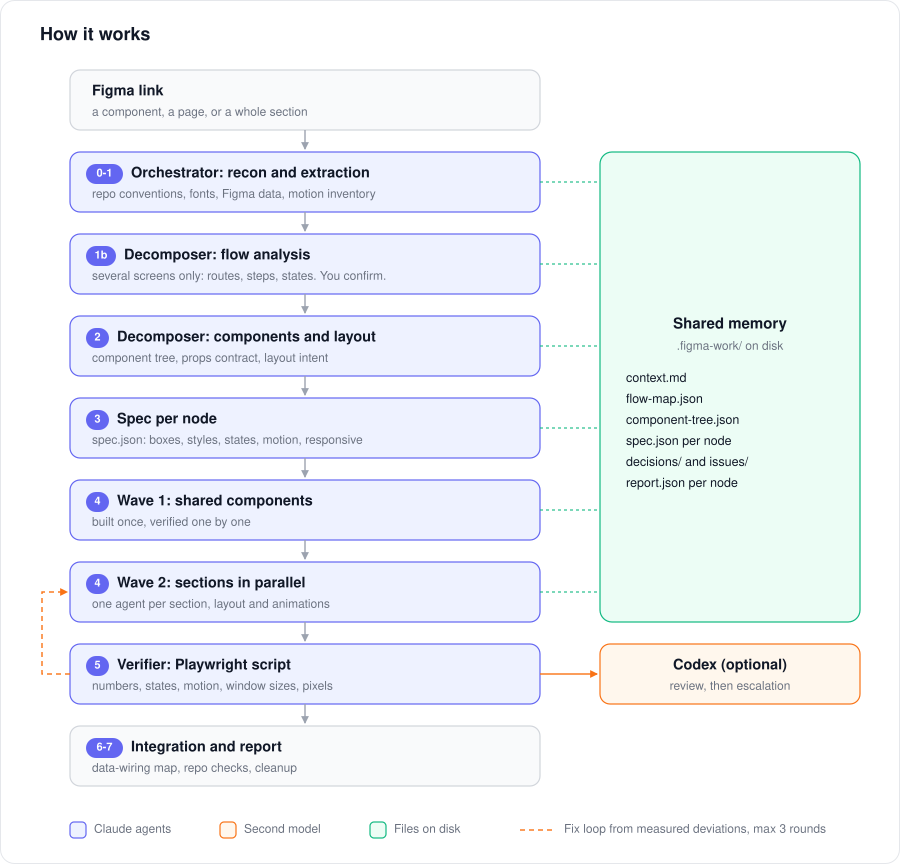
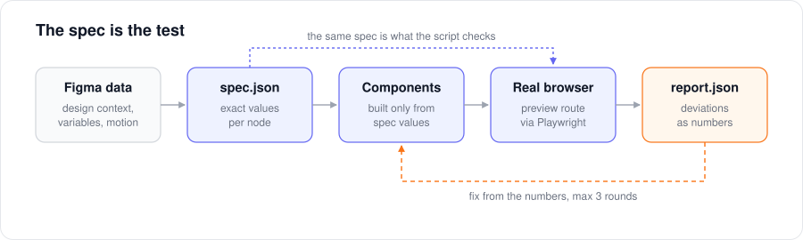
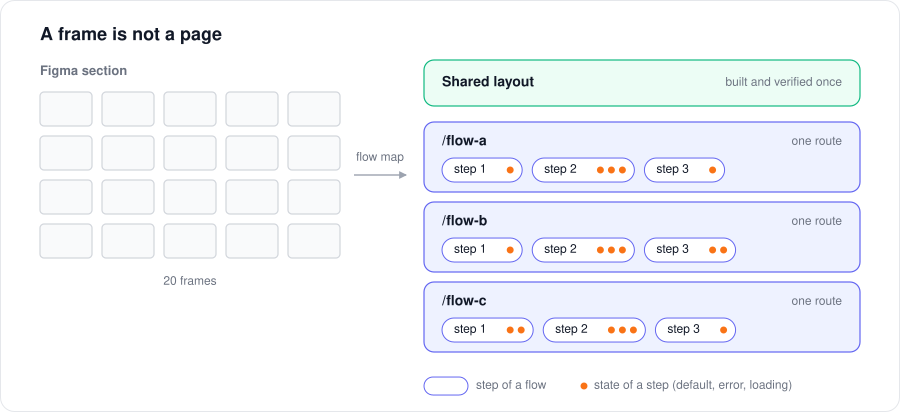

<h1 align="center">figma-to-react-pixel-perfect</h1>

<p align="center">
  An agent skill that implements the <b>UI layer</b> of a Figma design in React or Next.js with Tailwind v4:<br>
  pixel-perfect, animations included, and <b>measured</b> against the design instead of eyeballed.
</p>

<p align="center">
  
  
  
  
  
</p>

```bash
npx skills add veffev/figma-to-react-pixel-perfect
```

<p align="center">
  <picture>
    <source media="(prefers-color-scheme: dark)" srcset="docs/assets/pipeline-dark.svg">
    
  </picture>
</p>

It produces presentational components, skeletons and a props contract. It writes **no data-fetching code**: you wire your own server and client data libraries using the contract.

- [Why](#why)
- [What you get](#what-you-get)
- [How it works](#how-it-works)
- [Install and requirements](#install-and-requirements)
- [Usage](#usage)
- [Scripts](#scripts)
- [What has been tested](#what-has-been-tested)
- [Limits](#limits)

## Why

Ask an agent to "implement this Figma link" and the result usually resembles the design without matching it. The causes are always the same:

| What goes wrong | What this skill does about it |
|---|---|
| Values are estimated from a screenshot | Every value comes from Figma data and lands in a machine-readable `spec.json` |
| Animations are skipped (they live in a separate Figma tool nobody calls) | Motion is extracted, written into the spec, implemented and verified |
| "Verification" is a glance at a screenshot | A script compares the rendered page to the spec, element by element |
| The frame is copied as a fixed canvas, so the page only works at that size | The layout intent behind the frame is inferred and checked at several window sizes |
| Every frame becomes a page, even when frames are steps or states of one screen | Frames are mapped to routes, steps and states first, and you confirm the map |
| Two agents rebuild the same button differently | A decomposer builds the component tree first; shared pieces are built once |

## What you get

- **Presentational components** that follow your repo's conventions: language (TS or JS), lint rules, i18n, folders, existing primitives, animation library.
- **A skeleton** for every component with dynamic content, same outer size as the real one.
- **States and animations** present in the design, with exact durations, delays, easings and keyframes.
- **A data-wiring map**: for each component its props contract, its skeleton, a suggested loading boundary, and whether it is a Server or Client Component.
- **A development-only preview route** per node, fed with the exact content of the Figma frame.
- **`docs/figma/<frame>.json`**, the record that makes later design updates incremental.

What it never writes: `fetch`, SWR, TanStack Query, server actions, HTTP clients, data providers.

## How it works

### The pipeline

The diagram at the top of this page shows the full path for a page or a flow.

A single component runs through one agent (extract, spec, implement, verify). The full pipeline is for pages and flows.

### Phases

| # | Phase | Who | What happens | Left on disk |
|---|---|---|---|---|
| 0 | Recon | orchestrator | Detects Next or React. Reads language, lint rules, i18n, folders, existing components, tokens, breakpoints, animation library. Stops if a font used by the design is missing. | `context.md` |
| 1 | Extraction | orchestrator | Lightweight structure of the whole frame, variables, designer comments, motion inventory. Never the full design of a long page in one call. | `tree.json`, `motion-inventory.json` |
| 1b | Flow analysis | decomposer | Only with several screens. Reads the project's routes and existing flows, separates the shared shell from what changes, classifies every frame. **Stops for your confirmation.** | `flow-map.json` |
| 2 | Decomposition | decomposer | Component tree, static vs dynamic content, props contract, Server or Client, present and missing states, layout intent of pages. | `component-tree.json` |
| 3 | Spec | orchestrator | Reads the full design one node at a time and writes normalised values: boxes, styles, states, motion, responsive rules. | `spec.json`, `figma.png` |
| 4 | Implementation | section agents | Shared components first, then sections in parallel. Every spec element carries `data-figma-node`. | code, `decisions/`, `issues/` |
| 5 | Verification | verifier | A script opens the preview route and compares the result with the spec. The verifier is not the agent that wrote the code. | `report.json`, `impl.png`, `diff.png` |
| 6 | Integration | orchestrator | Assembles the page, re-verifies the whole frame, runs the repo's lint and type-check, writes the report. | final report |
| 7 | Cleanup | orchestrator | After your approval, saves a summary with spec hashes and deletes the working files. | `docs/figma/<frame>.json` |

### Agents and models

| Role | Model | Job |
|---|---|---|
| Orchestrator | strongest available | Coordinates phases, writes specs, integrates, settles conflicts |
| Decomposer | strongest available | Reads the project, analyses the flow, splits into components, decides structure |
| Implementers | mid-tier, one per section | Write components using only the values of their own spec |
| Verifier | a different agent from the author | Runs the scripts and reports deviations as numbers |
| Codex (optional) | a second model | Reviews the diff against the spec. If a node fails twice, implements it in parallel; the version with fewer measured deviations wins |

When the two models disagree, the measurement decides.

### Shared memory

Agents do not pass summaries to each other. They read and write files in `.figma-work/<frame>/` (git-ignored), the only memory that Claude, its subagents and Codex all see the same way.

```
shared/context.md            stack, conventions, tokens, fonts
shared/flow-map.json         routes, steps, states (several screens only)
shared/component-tree.json   the source of truth on components
shared/decisions/<agent>.md  append-only
shared/issues/<agent>.md     missing values, conflicts, questions for you
nodes/<nodeId>/spec.json     the spec of one node
nodes/<nodeId>/report.json   the verification result
```

One writer per file. Each agent reads the context, its own node of the tree and its own spec, not everything: too much context lowers precision.

### The spec is the test

<p align="center">
  <picture>
    <source media="(prefers-color-scheme: dark)" srcset="docs/assets/spec-loop-dark.svg">
    
  </picture>
</p>

For each node the skill writes the exact values from Figma. Implementers use only those; the script checks only those.

```json
{
  "nodeId": "45:120",
  "component": "PricingCard",
  "frame": { "width": 384, "height": 520, "screenshotScale": 2 },
  "layout": { "display": "flex", "direction": "column", "gap": 24, "padding": [32, 32, 32, 32] },
  "elements": [
    {
      "figmaNode": "45:121",
      "bind": "title",
      "box": { "x": 32, "y": 32, "w": 320, "h": 32 },
      "style": { "fontSize": 24, "lineHeight": 32, "letterSpacing": -0.48, "color": "rgb(11, 11, 15)" }
    }
  ],
  "states": { "hover": { "45:120": { "backgroundColor": "rgb(245, 245, 250)" } } },
  "motion": [
    { "figmaNode": "45:130", "trigger": "mount", "kind": "keyframes", "duration": 600, "delay": 100,
      "easing": "cubic-bezier(0.16, 1, 0.3, 1)",
      "keyframes": [
        { "offset": 0, "opacity": 0, "transform": "translateY(16px)" },
        { "offset": 1, "opacity": 1, "transform": "translateY(0px)" }
      ] }
  ],
  "fixture": { "title": "Pro plan" }
}
```

`bind` links an element to a prop. `fixture` holds the exact content of the frame: it feeds the preview and the verification and must never end up inside components.

### UI only: the props contract

For every text, image and number the decomposer decides whether it is part of the design (stays in the component, or goes to your i18n catalog) or content (becomes a prop). The final report turns that into a wiring map:

| Component | Props | Skeleton | Suggested loading boundary | Server / Client |
|---|---|---|---|---|
| `PricingCard` | `title`, `price`, `features` | yes, derived | no | server |
| `PlanSwitcher` | `plans`, `selected` | yes | yes | client |

Server or Client is decided on interactivity alone (UI state, events, JS-driven animation), never on where data comes from.

### Verification

`scripts/verify-node.mjs` opens the preview route with Playwright and checks:

| Check | What it measures | Tolerance |
|---|---|---|
| **Numeric gate** (decides) | Bounding box and computed styles of every element, root size and layout. A spec element missing from the DOM is a failure. | 1px boxes, 0.5px styles |
| States | Triggers hover, focus and pressed, waits for transitions, re-checks styles | exact |
| Motion | CSS transitions: property, duration, delay, easing. Keyframes: timing, `opacity` and `transform` values. A missing animation is a failure. | 1ms |
| Reduced motion | The final state stays correct under `prefers-reduced-motion` | 1px |
| Skeleton | Same outer box as the component with data | 1px |
| Other window sizes | Pages only: no overflow, no scroll on single-screen designs, margins, centring, overlaps | 1px |
| Pixel diff | Screenshot against Figma's. Secondary signal. | not gating |
| Purity | No data logic and no fixture values inside components | exact |

The output is a `report.json` of numeric deviations:

```json
{ "pass": false, "pixelDiff": 2.4, "failures": [
  { "figmaNode": "45:121", "property": "padding-top", "expected": 24, "actual": "20px" },
  { "figmaNode": "45:130", "property": "motion.duration", "expected": 600, "actual": 300 }
] }
```

The implementer fixes from the numbers. After three rounds, whatever is still open is declared in the report with its likely cause.

### Layout intent

A frame is one snapshot at one size. In the first real test the skill reproduced a login page that matched Figma at the frame size (1728×1117), with a fixed minimum height and absolute coordinates: on any other screen it scrolled and left empty space. The check passed, because it looked at one window only.

Three rules came out of that:

- The decomposer reads the structure behind the frame: what fills the window, what is a column, what is anchored to an edge, what is centred.
- Structure is built with flex or grid. Absolute frame coordinates are for decoration only. The frame's dimensions are never used as a fixed or minimum page size.
- With a single desktop frame, the skill still delivers a fluid layout and a stacked version for narrow windows, marks them as **derived**, and asks you to confirm.

The rules are written into the page spec and verified at several viewports:

```json
"responsive": {
  "singleScreen": true,
  "stackBelow": 1024,
  "viewports": [[1280, 720], [1440, 900], [1920, 1080], [2560, 1333], [390, 844]],
  "anchors": [{ "figmaNode": "5256:21972", "edges": { "top": 8, "right": 32, "bottom": 8, "left": "50%+10" } }],
  "centered": [{ "figmaNode": "3020:17838", "axis": "y", "offset": -16 }],
  "noOverlap": [["3020:17838", "5256:21972"]]
}
```

### Several screens: flow analysis

<p align="center">
  <picture>
    <source media="(prefers-color-scheme: dark)" srcset="docs/assets/frames-to-flows-dark.svg">
    
  </picture>
</p>

A frame is not a page. Given a section with many screens, the decomposer reads the project first (routes, layouts, how existing multi-step flows are built) and classifies each frame:

| Relation between frames | Becomes |
|---|---|
| Different flows (each with its own purpose and entry point) | separate routes |
| Steps of one flow | steps inside one route, using the mechanism the project already uses |
| The same step in different conditions (empty, error, loading) | states of the same component |
| The same content at different widths | one layout on the repo's breakpoints |
| Parts identical in every frame | a shared layout, built and verified once |
| A sheet of variants | a component's variants, not a screen |

It writes a flow map, shows it to you and **stops**. Whether a step is a route or a state is an architecture decision, and it is yours. Work then proceeds one group at a time and scales with the number of distinct changing regions, not with the number of frames.

### When the design changes

On approval the skill saves, per component, the Figma node, the code file and a hash of its spec. Run it again after the designer edits the frame and it recomputes the hashes and reworks only the nodes that changed. A change in the props contract is flagged prominently, because it breaks the data wiring you wrote.

## Install and requirements

```bash
npx skills add veffev/figma-to-react-pixel-perfect
```

Or copy this folder into your agent's skills directory (for Claude Code: `.claude/skills/` in a project, or `~/.claude/skills/`).

- The **Figma MCP server**, connected. Figma's own `figma-design-to-code` skill is read from the server when it is not installed.
- **Tailwind CSS v4** in the target project.
- **Playwright** in the target project, with Chromium:
  ```bash
  npm i -D @playwright/test && npx playwright install chromium
  ```
- Optional: the **Codex CLI**, authenticated, for the second-model review.

## Usage

One component or one page:

```
/figma-to-react-pixel-perfect Implement this design from Figma.
https://www.figma.com/design/<file>/<name>?node-id=12-345
```

A section with several screens (analysis first, no code):

```
/figma-to-react-pixel-perfect
This Figma section contains several screens of one flow:
https://www.figma.com/design/<file>/<name>?node-id=1-2

Do the flow analysis only. Read the project first, inventory every screen,
find the shared shell, classify each screen, write the flow map and show it to me.
Then stop and wait for my confirmation.
```

After a design change:

```
/figma-to-react-pixel-perfect The design changed, update the implementation.
https://www.figma.com/design/<file>/<name>?node-id=12-345
```

## Scripts

Run from the target project root. The only runtime dependency is Playwright, resolved from the target project.

| Script | Purpose |
|---|---|
| `scripts/verify-node.mjs` | numeric gate, states, motion, reduced motion, skeleton size, other window sizes, optional pixel diff; writes `report.json` |
| `scripts/purity-check.mjs` | fails if component files contain data logic or hardcoded fixture values |
| `scripts/spec-hash.mjs` | stable hash of a spec, for incremental updates |

```bash
node <skill>/scripts/verify-node.mjs \
  --spec .figma-work/<frame>/nodes/<id>/spec.json \
  --url http://localhost:3000/figma-preview/<id> \
  --figma .figma-work/<frame>/nodes/<id>/figma.png
```

## Repository layout

```
SKILL.md                 scope, principles, phases, fixed rules
references/              one guide per phase, read only when that phase starts
  recon.md  flow-analysis.md  decomposer.md  layout-intent.md
  spec.md  figma-css-mapping.md  motion.md  implementation.md
  verification.md  codex.md  incremental-update.md
scripts/                 verify-node.mjs  purity-check.mjs  spec-hash.mjs
assets/                  JSON schemas and preview route templates
docs/assets/             diagrams used in this README
```

## What has been tested

| Tested | Not tested yet |
|---|---|
| The scripts, on test pages that are correct and on pages with deliberate errors, and on a Next.js 16 project | Flow analysis on a real section with many screens |
| A real login page implemented from a Figma frame, with four looping animations extracted and verified | The React (non-Next) branch end to end |
| The multi-viewport check, on a fixed-layout page (fails) and a fluid one (passes) | The incremental update after a design change |

## Limits

- Timing of JS-driven animation (springs) is not verified by script; it is reported as a warning.
- The pixel comparison is a simple per-channel threshold. Text anti-aliasing differs between Figma and Chromium, so some diff on text is expected. The numeric gate is the one that decides.
- States other than hover, focus and pressed need their own preview state and spec.
- Reading layout intent and flows depends on the model. That is why the skill shows what it inferred and asks you to confirm.
- Values, states and transitions missing from the Figma file are not invented: the skill asks.

## License

MIT
